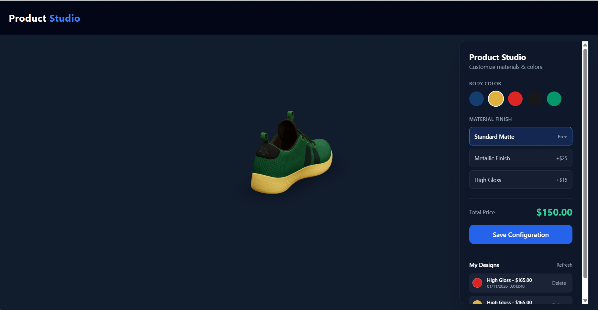

# Product Configurator

An interactive full stack product configurator for previewing color and material finishes on a 3D product, calculating a server-authoritative price, and saving designs to SQLite.

## Features

- Interactive 3D preview with orbit controls, auto-rotation, environment reflections, and soft shadows.
- Five body colors and three PBR finishes: Standard Matte, Metallic Finish (+$25), and High Gloss (+$15).
- Smooth finish and color transitions, with responsive controls for small screens.
- Server-calculated prices and validated configuration values.
- Save, reload, and delete recent designs.
- Uses a cube when no product model is installed.

## Tech stack

- Client: React 18, Vite, Three.js, React Three Fiber, drei, Zustand, Tailwind CSS.
- Server: Node.js, Express, better-sqlite3.
- Database: SQLite (`server/database/dev.sqlite`), initialized and seeded by the server.

## Setup (Windows PowerShell)

Use two PowerShell windows from the repository root.

### Server

```powershell
cd server
npm install
Copy-Item .env.example .env
npm run dev
```

The API listens on `http://localhost:5000` by default. Set `PORT` in `server/.env` to change it.

### Client

```powershell
cd client
npm install
npm run dev
```

Open the Vite URL shown in the terminal (normally `http://localhost:5173`). Vite proxies `/api` requests to `http://localhost:5000`.

## 3D model

To replace the fallback cube, put a glTF binary model at `client/public/models/product.glb`. The viewer centers and scales it to fit and applies the selected finish and color to its meshes. For a free CC0 model, browse [Poly Haven's model library](https://polyhaven.com/models) and download a glTF/GLB asset; Poly Haven states its models are released under CC0 ([license details](https://polyhaven.com/license)).

## Environment variables

| Variable | Used by | Default | Description |
| --- | --- | --- | --- |
| `PORT` | Server | `5000` | Express server port |

Copy `server/.env.example` to `server/.env` before starting the server. Environment files are ignored by git.

## API

| Method | Endpoint | Description |
| --- | --- | --- |
| `GET` | `/api/product` | Get the catalog product |
| `POST` | `/api/config` | Validate and save `{ productId, color, material }`; the server calculates `totalPrice` |
| `GET` | `/api/configurations` | Get the 20 most recently saved designs |
| `DELETE` | `/api/configurations/:id` | Delete a saved design |

## Screenshot and demo



Live demo: [Add demo URL](#)
